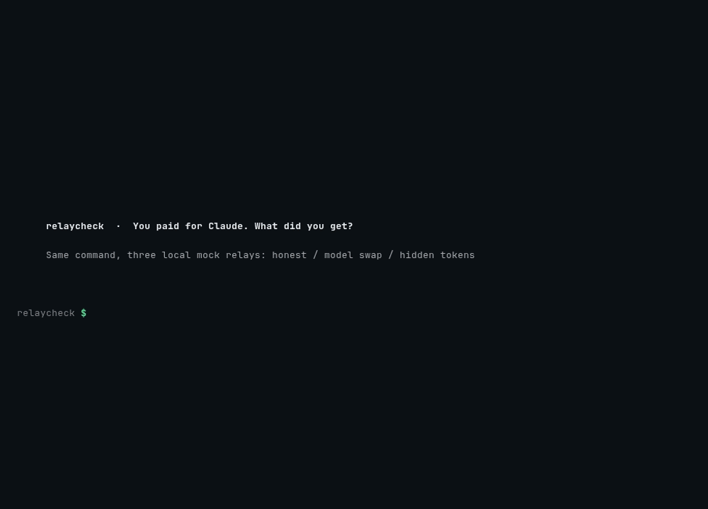
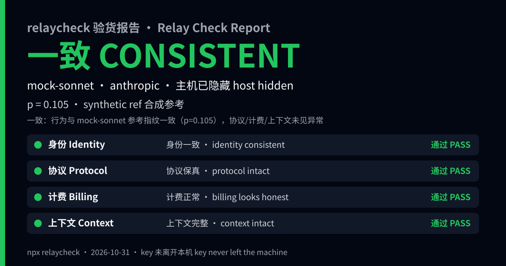
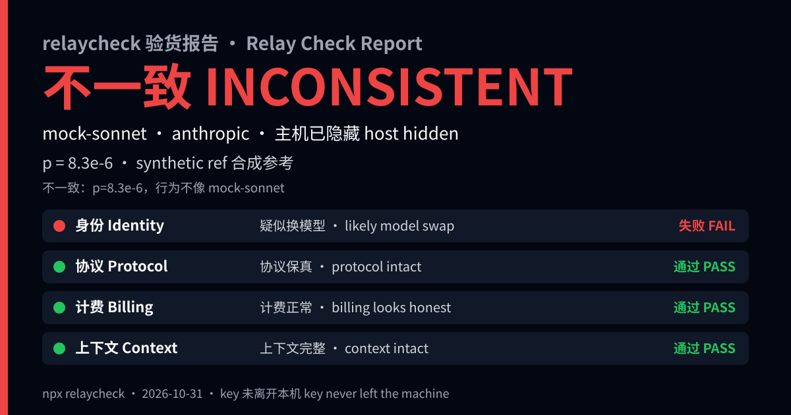

<div align="center">

# relaycheck

**You paid for Claude. What did your relay actually give you?**

Statistically test whether an LLM API relay, proxy or gateway serves the model it claims, bills the tokens it should, and keeps your context intact. One command. Your key never leaves your machine.

[English](README.md) · [简体中文](README.zh-CN.md)



</div>

```bash
export RELAY_KEY=sk-...    # read only from an env var, never from argv
npx relaycheck https://relay.example.com --model claude-sonnet-4-5 --card card.svg
```

```
✗ INCONSISTENT  p = 0.0003  — answers don't match claude-sonnet-4-5's fingerprint
                 +512 hidden input tokens billed per request
  identity  FAIL   protocol  PASS   billing  FAIL   context  PASS
```

## Why

Third-party relays are everywhere, especially for Claude Code and Codex users who can't reach official APIs directly. Some quietly swap in a cheaper model, inject hidden system prompts you pay for, or truncate long context. A 2026 shadow-API study found **45.8% of 24 endpoints failed fingerprint verification**. "It feels dumber today" isn't evidence. A p-value is.

## What it checks

| Group | How |
|---|---|
| **Identity** | 24 finite-choice probes × N samples at temperature 1 (probe set v2). Each answer distribution is compared to a reference fingerprint with a Monte Carlo permutation χ² test (mid-p, over-dispersion corrected), then merged into one endpoint p-value with the Cauchy combination test. |
| **Protocol** | The things coding agents depend on: tool-use round trip, SSE event sequence, stop sequences, max_tokens truncation, `model` echo, Anthropic thinking blocks and signatures. |
| **Billing** | Reported `usage` vs. the **official** token counts stored in the reference (or `count_tokens`; a local estimate is labelled uncalibrated) exposes hidden injected tokens to the token; checks that prompt caching really hits. |
| **Context** | Three needles (10/50/90 % depth) at 2k (control) and 32k tokens; `--deep` adds 100k. Misses are re-tested before calling truncation. |

Speaks Anthropic Messages, OpenAI Chat Completions and OpenAI Responses (`--api auto`).

## Output

- A one-line verdict plus per-group evidence in your terminal (`--lang en|zh`)
- `--json` for CI, `--html` for a full report
- `--card` renders a 1200×630 bilingual share card (SVG). The relay host is hidden by default (`--show-host` to show it). Need a PNG? `rsvg-convert card.svg -o card.png`, or open the SVG in a browser and screenshot it; relaycheck stays dependency-free, so it doesn't rasterise itself.

<p align="center"> </p>

Exit codes: `0` consistent · `1` inconsistent · `2` inconclusive · `3` error. Drop it in CI to watch the relay your team depends on.

## Try it with no key

```bash
git clone https://github.com/YanYunCY/relaycheck && cd relaycheck
npm install && npm run build
bash scripts/demo.sh    # an honest mock relay vs. a model-swapping one
```

Mock kinds: `honest`, `swap`, `inject` (+512 hidden tokens), `truncate` (drops everything past 8k).

## Real-world check

We ran relaycheck against the official OpenAI API. All numbers are from [docs/METHOD.md](docs/METHOD.md), where you can also reproduce them.

- **Genuine gpt-6-luna is consistent.** We ran 20 independent identity checks of the official API, 24 samples × 24 probes each (11,520 requests), against `refs/gpt-6-luna.json`. All 20 passed: 0 fail, 0 warn, lowest p = 0.105. A full check with every group and `--deep` 100k gave p = 0.722, with billed input tokens equal to the official count.
- **Other models claimed as gpt-6-luna are caught.** gpt-5.6-luna (same family) failed 10 of 10 runs (median p = 6.9·10⁻¹⁵), gpt-5-nano failed 5 of 5 (median p = 1.8·10⁻¹⁸) and gpt-5.4-nano failed 5 of 5 (median p = 4.2·10⁻¹⁷).
- **A real swapped relay.** A local proxy forwarded gpt-5.6-luna upstream and rewrote the `model` field to gpt-6-luna. relaycheck reported `INCONSISTENT p=7.2e-15`, even though protocol, billing and context all looked clean.
- **Hidden prompt injection.** A proxy that prepended a short hidden system prompt was caught exactly: *+37 input tokens per request*.
- **Calibration.** In thousands of simulated null runs, the false-alarm rate is at or below the nominal level: 0.05 % at the fail threshold (p < 0.001) and 0.8 % at warn (p < 0.01).

What it cannot see: a relay that serves the genuine model most of the time. At 24 samples, an 80 %-genuine mix is flagged as fail only 7.8 % of the time. It also cannot see vendor model updates, or near-identical variants. These are evidence, not proof. Read the [limitations](docs/METHOD.md#7-limitations-what-relaycheck-cannot-tell-you).

## Build your own reference

```bash
RELAY_KEY=$ANTHROPIC_API_KEY npx relaycheck fingerprint https://api.anthropic.com --model claude-sonnet-4-5 --out refs/claude-sonnet-4-5.json
```

Use a trusted endpoint, and use the same `--api` and `--reasoning-effort` you will check with. The reference records the probe-set version, sampling settings, an over-dispersion estimate and exact billing baselines for each protocol. References from 0.1 (probe set v1) still load, with a warning to regenerate them.

## Privacy

Your key is read from an environment variable only, sent only to the URL you pass, and redacted from every output. No telemetry, no server.

## Limits, honestly

Statistical verdicts are evidence, not proof. A relay that is genuine most of the time, or that recognises relaycheck's fixed probes, can pass. Fingerprints drift when vendors update models, so regenerate references from a trusted endpoint. Billing is exact only against a reference baseline or `count_tokens`; otherwise it is labelled uncalibrated. Full method and numbers: [docs/METHOD.md](docs/METHOD.md). relaycheck will never publish a name-and-shame list. You decide what to share.

## Prior art

Methods build on DFA (arXiv 2610.37086), API-TAIL (arXiv 2610.36801) and KBF (arXiv 2605.29524). Related tools: relay-guard, RelayScope, fpverify, claude-detector.

MIT License
