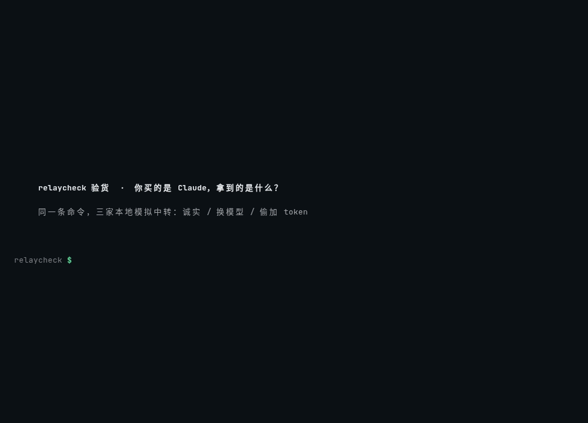

<div align="center">

# relaycheck 验货

**你买的是 Claude，中转给你的到底是什么？**

一行命令，用统计检验验证 LLM 中转站 / 代理 / 网关：模型是不是真的、token 有没有多算、长上下文有没有被截。key 永不离开本机。

[English](README.md) · [简体中文](README.zh-CN.md)



</div>

```bash
export RELAY_KEY=sk-...    # 只从环境变量读取，不接受命令行明文
npx relaycheck https://relay.example.com --model claude-sonnet-4-5 --lang zh --card card.svg
```

```
✗ 不一致  p = 0.0003 —— 回答分布与 claude-sonnet-4-5 指纹不符
          每次请求多计 512 个输入 token
  身份 FAIL   协议 PASS   计费 FAIL   上下文 PASS
```

## 为什么做这个

用 Claude Code、Codex 的国内开发者大多离不开中转，可“今天是不是降智了”“是不是掺了便宜模型”“怎么 token 用得这么快”一直没法证明。2026 年一项影子 API 研究测了 24 个端点，**45.8% 没通过指纹验证**。感觉不算证据，p 值才算。

## 测什么

| 组 | 方法 |
|---|---|
| **身份** | 24 个有限选项探针（探针集 v2），temperature=1 下各采样 N 次，与参考指纹逐题做蒙特卡洛置换卡方检验（mid-p、过离散校正），再用 Cauchy 组合检验合成一个总 p 值 |
| **协议** | coding agent 真正依赖的东西：工具调用往返、SSE 事件序列、stop_sequences、max_tokens 截断、model 回显、Anthropic thinking 块与签名 |
| **计费** | 用参考指纹里存的**官方** token 数（或 count_tokens；本地估算会标为“未校准”）逐 token 对比 usage，揪出隐藏注入；检查 prompt cache 是否真的命中 |
| **上下文** | 在 2k（对照）和 32k 文档的 10%/50%/90% 深度各埋一根针；`--deep` 加测 100k；漏针会先复测再判截断 |

支持 Anthropic Messages、OpenAI Chat Completions、OpenAI Responses（`--api auto` 自动识别）。

## 输出

- 终端一行结论 + 分组证据（`--lang zh|en`）
- `--json` 给 CI 用，`--html` 生成完整报告
- `--card` 生成 1200×630 中英双语分享卡（SVG），默认隐藏中转域名（`--show-host` 显示）。要 PNG：`rsvg-convert card.svg -o card.png`，或用浏览器打开 SVG 截图；relaycheck 保持零依赖，不内置栅格化。

<p align="center"> </p>

退出码：`0` 一致 · `1` 不一致 · `2` 存疑 · `3` 运行错误。放进 CI，就能定时盯住团队在用的中转。

## 无需 key 先体验

```bash
git clone https://github.com/YanYunCY/relaycheck && cd relaycheck
npm install && npm run build
LANG_OPT=zh bash scripts/demo.sh    # 老实的假中转 vs 偷换模型的假中转
```

假中转类型：`honest`、`swap`（换模型）、`inject`（每次多计 512 token）、`truncate`（8k 之后全丢）。

## 真实测试

我们用 relaycheck 测了官方 OpenAI API。数字都来自 [docs/METHOD.zh-CN.md](docs/METHOD.zh-CN.md)，那里也写了怎么复现。

- **官方 gpt-6-luna 一致。** 对 `refs/gpt-6-luna.json` 做了 20 次独立的身份检测，每次 24 个探针 × 24 次采样，共 11,520 次请求。20 次全部通过：0 次不一致，0 次存疑，最小 p = 0.105。全组检查（含 `--deep` 100k）p = 0.722，计费与官方 token 数逐个一致。
- **冒充 gpt-6-luna 的其他模型被抓到。** gpt-5.6-luna（同一家族）10/10 次判为不一致（p 中位数 6.9·10⁻¹⁵），gpt-5-nano 5/5（中位数 1.8·10⁻¹⁸），gpt-5.4-nano 5/5（中位数 4.2·10⁻¹⁷）。
- **真实的换模型中转。** 本地代理把请求转给 gpt-5.6-luna，并把 `model` 字段改回 gpt-6-luna。relaycheck 判定 `不一致 p=7.2e-15`，而协议、计费、上下文全部看起来正常。
- **更多参考指纹（2026-10-31）。** 新增 gpt-6.1-sol、gpt-6.1-terra、gpt-6-astra、gpt-5.3-codex 的真实指纹。官方自测 7/7 一致（p 0.43–0.96）。拿 gpt-6-luna 冒充它们：7/7 抓到（p ≤ 1.2·10⁻⁵）。拿 gpt-6.1-terra 冒充 gpt-6.1-sol：抓到，p = 1.6·10⁻¹⁴。
- **我们自己找到的盲区。** 拿 gpt-6.1-sol 冒充 gpt-6-astra **没抓到**（p = 0.024，判为一致）。两者的回答分布几乎一样（平均 JS 0.017，相当于两次官方自测之间的噪声），tokenizer 计数也相同。目前的采样探针分不出这两个，需要加「能力型」探针。欢迎一起想办法。
- **隐藏提示注入。** 每次偷偷加一段系统提示的代理被精确抓到：*每请求多计 37 个 input token*。
- **校准。** 数千次模拟的零假设运行中，误报率不超过名义水平：不一致阈值（p < 0.001）为 0.05%，存疑阈值（p < 0.01）为 0.8%。

测不出来的：大部分时间转发真模型的中转（24 次采样时，80% 真货的混合只有 7.8% 判为不一致），厂商更新模型，以及几乎相同的变体。这些都是证据，不是铁证。详见[局限](docs/METHOD.zh-CN.md#7-局限relaycheck-测不出什么)。

## 自己生成参考指纹

```bash
RELAY_KEY=$ANTHROPIC_API_KEY npx relaycheck fingerprint https://api.anthropic.com --model claude-sonnet-4-5 --out refs/claude-sonnet-4-5.json
```

请用可信端点生成参考指纹，`--api` 和 `--reasoning-effort` 要与之后检测时一致。参考文件会记录探针集版本、采样设置、过离散估计，以及每种协议的精确计费基准。0.1 版（探针集 v1）的参考文件仍可读取，但会提示你重新生成。

## 隐私

key 只从环境变量读取，只发给你指定的地址，所有输出里都脱敏。没有遥测，没有服务器。

## 局限，说清楚

统计结论是证据，不是铁证。大部分时间给真货、或能识别 relaycheck 固定探针的中转可能通过检测。官方更新模型后指纹会漂移，需要用可信端点重新生成。计费只有在有参考基准或 count_tokens 时才精确，否则会标为“未校准”。完整方法与数据见 [docs/METHOD.zh-CN.md](docs/METHOD.zh-CN.md)。relaycheck 永远不做点名黑榜，分享与否由你决定。

业余维护。参考指纹每月由 CI 自动重录；其他模型的指纹欢迎通过 PR 贡献到 `refs/`。

更多问题见 [常见问题](docs/FAQ.zh-CN.md)。

## 方法来源

DFA（arXiv 2610.37086）、API-TAIL（arXiv 2610.36801）、KBF（arXiv 2605.29524）。相关项目：relay-guard、RelayScope、fpverify、claude-detector。

MIT 许可证
